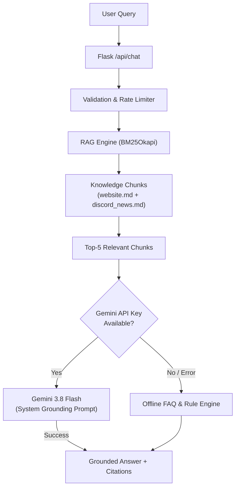

# µLearn Concierge ✦

> An exquisite, reliable AI assistant crafted for **µLearn CHN** (College of Engineering Chengannur) for the **AI Interest Group Lead** selection task.

[](https://python.org)
[](https://flask.palletsprojects.com/)
[](https://github.com/dorianbrown/rank_bm25)
[](https://aistudio.google.com/)
[](#)

---

## Overview & Philosophy

**µLearn Concierge** is designed to feel like a private members' lounge: quiet confidence, refined typography, and purposeful motion. Unlike generic, loud AI templates, this concierge delivers accurate, verified knowledge about the **µLearn platform** ([mulearn.org](https://mulearn.org)): Interest Groups, Karma points, campus chapters, learning circles, events, and announcements.

### Key Highlights
- **Strictly Grounded (No Hallucinations)**: The concierge answers solely from curated website knowledge and synced Discord announcements. If an answer isn't in its sources, it honestly admits it: *"I'm not certain. Please check mulearn.org or the µLearn Discord."*
- **Source Citations**: Every response cites its authoritative source with direct links (*µLearn Website* or *µLearn Discord #announcements*).
- **Dual-Mode Architecture (Zero Crash Guarantee)**: Powered by **BM25 Retrieval-Augmented Generation (RAG)** and **Gemini 3.8 Flash** (via the modern `google-genai` SDK). If no API key is provided or the API is unavailable, the concierge seamlessly falls back to an offline rule-based keyword/FAQ engine.
- **On-Demand Discord Sync**: Ingests announcements from the central GTech µLearn announcements feed via channel following, parsing direct messages, rich embeds, and forwarded `message_snapshots`.
- **Luxury Aesthetic**: Midnight navy (`#070B16`), soft ivory typography, champagne-gold accents (`#C9A96E`), subtle glassmorphism, floating particles, typewriter text delivery, and full `prefers-reduced-motion` compliance.

---

## User Interface & Design

```
┌────────────────────────────────────────────────────────┐
│                      µLearn CHN                        │
│          Your concierge to the µLearn universe         │
│                                                        │
│  ┌──────────────────────────────────────────────────┐  │
│  │ ● µLearn Concierge                            [+]│  │
│  │ ──────────────────────────────────────────────── │  │
│  │ [µ] Welcome! I'm your µLearn Concierge. Ask me   │  │
│  │     anything about µLearn, Interest Groups,      │  │
│  │     Karma points, or the latest news.            │  │
│  │                                                  │  │
│  │ [What is µLearn?]  [Karma Points?]  [Latest news]│  │
│  │ ──────────────────────────────────────────────── │  │
│  │ [ Ask me anything about µLearn...           (↑) ]│  │
│  └──────────────────────────────────────────────────┘  │
│                                                        │
│    Built for µLearn CHN · College of Engineering CEC   │
│            News last synced: 2026-11-05 20:30          │
└────────────────────────────────────────────────────────┘
```

### Visual Proof / Screenshots
<!-- Add your recorded screenshots below -->
- **Desktop Concierge View**: ``
- **Mobile Responsive View (360px)**: ``
- **Source Citation & Typewriter**: ``

---

## Scroll-Driven 3D Intro Experience & Studio Setup

µLearn Concierge features an interactive, scroll-driven WebGL intro that takes visitors on a cinematic journey from the µLearn cosmos into an executive developer workstation, before seamlessly zooming through the laptop display directly into the live concierge chatbot interface.

### 1. Architecture & Tech Stack
- **Continuous, Fully Reversible Timeline**: Bound to a single master **GSAP** timeline scrubbed via **ScrollTrigger** (`scrub: 1` smoothing) across a `600vh` scroll distance. Scrolling backwards replays every movement and rotation in exact reverse.
- **Two-State Finite State Machine (`SCENE` & `CHAT`)**: A clean FSM governing scene scrub (0%–92%) and a dedicated 2.4s time-based flash swap (0.8s flash in, 0.6s hold, 1.0s flash out). During CHAT mode, the 3D scene, canvas, and ticker are paused for maximum client performance.
- **Dynamic Camera Target Computation**: Camera positions for Phase 4 (Laptop Overview) and Phase 5 (Screen Zoom-in) are computed dynamically via `computeScreenCameraTargets()` from the `laptopScreenMesh` world position and normal vector. Even if stand height, desk position, or viewport aspect ratio change, the camera mathematically aligns perpendicular to the display, ensuring the screen fills the viewport with zero bezel or frame clipping.
- **Smooth Momentum Scrolling**: Integrated with **Lenis** (`autoRaf: false`, driven by GSAP ticker, with `lagSmoothing(0)`).
- **Zero External CDNs**: All client libraries (**Three.js r160**, **GSAP 3.12.5**, **ScrollTrigger 3.12.5**, and **Lenis 1.1.18**) are vendored locally in `static/vendor/` for self-contained, offline-capable deployments.
- **Real-World Scale & Procedural Textures**: Real-world scale in metres. Features procedural walnut wood grain, dark oak parquet floor, navy leather desk mat with stitched gold perimeter, contact shadow occlusion maps, and rising tea steam sprite textures generated on HTML5 2D canvases.

### 2. The 6 Reversible Phases

```
0% ──────────── 15% ──────────── 35% ──────────── 55% ──────────── 75% ──────────── 92% ────── 100%
  [ PHASE 1 ]         [ PHASE 2 ]         [ PHASE 3 ]         [ PHASE 4 ]         [ PHASE 5 ]   [ PHASE 6 ]
   HERO LOGO           APPROACH            TRANSFORM           LAPTOP              ZOOM IN       FLASH & SWAP
   Bobbing gold        Dolly in,           Logo dissolves,     Align directly      Push into     2.4s time-based
   µ monogram in       rotate ~90° L,      particles stream,   facing screen       display       white flash
   starfield           rim light glint     workspace builds    with live preview   until edges   reveals live
                                           lamp turns on                           fill screen   #chat UI
```

1. **Phase 1: HERO (0% – 15%)**:
   - The champagne-gold µLearn emblem floats in the center against a midnight-navy starfield with dual orbital rings.
   - Gentle idle bobbing motion and subtle background starfield drift.
   - Animated "Scroll to enter" mouse indicator fades out upon scrolling.
2. **Phase 2: APPROACH (15% – 35%)**:
   - Camera dollies in toward the medallion.
   - The logo rotates ~90° toward the left, catching specular glints from warm champagne rim lights.
3. **Phase 3: TRANSFORM (35% – 55%)**:
   - The logo spins rapidly, dissolving into a stream of 550 golden particles that cascade down onto the desk surface.
   - The studio workspace and room architecture assemble with staggered spring physics: dark oak floor, navy paneled wall, walnut desk, aluminium laptop riser, tea glass, photo frame, books, succulent, and headphone stand glide into place.
   - At the end of Phase 3, the articulated brass desk lamp turns on, bathing the desk in a warm 2700K pool of light.
4. **Phase 4: LAPTOP (55% – 75%)**:
   - Camera glides over the desk, lowering and aligning perpendicular to the open laptop screen based on dynamic mesh coordinates.
   - The laptop display renders an ultra-crisp (2560×1600) preview texture of the real chatbot UI (`static/img/chat-preview.png`).
5. **Phase 5: ZOOM IN (75% – 92%)**:
   - Camera pushes directly into the laptop screen along its normal vector.
   - The screen borders expand past the camera frustum until the screen texture completely occupies the viewport with no bezel clipping.
   - Over the final stretch (80%–92%), a procedural white fade mesh crossfades the display to pure white for a seamless transition.
6. **Phase 6: FLASH & SWAP (92% – 100%)**:
   - Triggers the 2.4s time-based white flash swap: 0.8s fade in to pure white, 0.6s hold (hiding 3D canvas, stopping RAF loop, unlocking full-viewport `#chat`), and 1.0s fade out.
   - The user immediately arrives in the fully interactive `#chat` interface.
   - Clicking `Back to 3D scene` or scrolling up from the top of `#chat` triggers the reverse swap back to Phase 5, restoring smooth bi-directional exploration.

### 3. Studio Architecture & Desk Props

All 3D models were created procedurally in Three.js at real-world scale in metres:
- **Room Architecture**: Dark oak parquet floor ($8\text{m} \times 8\text{m}$) with subtle reflection, midnight navy back wall with vertical batten paneling and baseboard, left architectural window opening to the cosmic starfield with a cool-blue glow, and a wall-mounted framed µLearn poster with a brass picture light.
- **Dark Walnut Desk**: $1.60\text{m} \times 0.75\text{m}$ walnut top ($3\text{cm}$ thick, top surface at $0.75\text{m}$) with procedural longitudinal wood grain (`roughness: 0.55`), slim black steel trestle legs with rear support bar, cable grommet, and tidy braided cables.
- **Aluminium Riser Stand & Laptop**: Angled brushed-aluminium riser stand ($15\text{cm}$ rear elevation, $18^\circ$ tilt). Space-gray laptop chassis open at ~108° relative to base (~10° tilt past vertical), putting the screen at eye level. Screen mapped with 2560×1600 sRGB texture.
- **Leather Desk Mat, Keyboard & Mouse**: Midnight navy leather mat with gold stitched perimeter border, ultra-slim wireless keyboard, and ergonomic wireless mouse.
- **Articulated Brass Desk Lamp**: Articulated arm with knurled joints and conical shade angled clearly **downward** toward the desk and notebook. Houses a warm 2700K `SpotLight` (`#FFB066`) with soft PCF shadows and an emissive bulb.
- **Glass of Tea**: Lathe-geometry clear tea glass with physical transmission (`MeshPhysicalMaterial`, transmission 0.98, ior 1.52, roughness 0.04), amber tea liquid, brass holder, saucer, spoon, mint leaf, and 4 rising steam sprite particles that drift and fade.
- **Desk Photo Stand with Original µLearn Logo**: $12\text{cm} \times 16\text{cm}$ desk frame tilted backward 10° with a hinged rear easel leg, brushed-brass bezel, dark navy mat, and glass front. Displays `static/img/mulearn-original.png` in original colors, loaded with sRGB colorSpace, mipmaps, max anisotropy, and 1:1 aspect ratio preserved.
- **Hardcover Book Stack & Notebook**: Navy cloth hardcover book, charcoal book rotated 5°, closed leather journal with gold ribbon bookmark, and turned brass ballpoint pen.
- **Succulent & Headphone Stand**: Potted rosette succulent in dark slate pot, and modern over-ear headphones hanging **vertically** on a slim brass stand.
- **Contact Shadows**: Soft radial gradient ambient occlusion planes placed under every desk object for natural grounding without heavy shadow map cost.

### 4. 3-Point Lighting & Environment
- **Key Light**: Desk lamp `SpotLight` (warm 2700K `#FFB066`, soft PCF shadows, shadow radius 4, bias tuned to prevent acne).
- **Fill Light**: Cool-blue window `HemisphereLight` (`0x32526E` / `0x070B16`, intensity 0.45) from the window side.
- **Rim / Wall Wash**: Soft warm `PointLight` behind the laptop washing the navy back wall, separating the laptop lid and poster silhouette from the background.
- **Harsh Gradient Eliminated**: The misplaced directional light that caused the harsh left-to-right gold sweep has been completely removed.
- **Procedural Environment Map**: Low-intensity environment generated via `PMREMGenerator` for subtle specular reflections on glass and metals.

### 5. Performance & Mobile Optimizations
- **60 FPS Target**: Only the desk lamp casts real-time shadows; shadow map capped at 1024×1024; physical transmission restricted solely to the tea glass.
- **Mobile Viewport (390px)**: Shadow maps are automatically disabled, and steam particle count is reduced on mobile viewports for fluid 60 FPS performance.
- **Device Pixel Ratio**: Capped at 2 to prevent excessive fragment shading on ultra-high-DPI screens.

### 6. Automated Verification & Test Results

Run the Chrome DevTools Protocol (CDP) automated test suite against a real headless browser instance:
```bash
python scripts/test_refined_scene.py
```

| Verification Item | Requirement / Metric | Measured Result | Status |
|---|---|---|---|
| **Scene Initialization** | Three.js scene, camera, renderer initialized | Initialized with 11 prop groups | **PASS** |
| **Key Lighting** | Warm 2700K SpotLight from downward lamp | `#FFB066`, 1024 map, soft PCF shadows | **PASS** |
| **Harsh Sweep Removed** | No misplaced directional gold sweep | Replaced by subtle back wall wash | **PASS** |
| **Desk Lamp Turn-On** | Lamp turns on at end of Phase 3 | Intensity ramps from 0 to 2.68 | **PASS** |
| **Laptop Riser Stand** | Brushed aluminium stand, 110° open screen | Screen normal `(0, 0.175, 0.985)` facing user | **PASS** |
| **Tea Glass Physicality** | Lathe geometry, physical transmission | `MeshPhysicalMaterial`, trans 0.98, ior 1.52 | **PASS** |
| **Original Logo Frame** | `mulearn-original.png`, 10° tilt, easel leg | sRGB colorSpace, mipmaps, max anisotropy | **PASS** |
| **Dynamic Camera (P4 & P5)** | Computed from screen world pos & normal | Phase 4 overview + Phase 5 perpendicular zoom | **PASS** |
| **Phase 5 Screen Fill** | Screen fills viewport, no bezel clipping | `fillDist = 0.206m` with tight framing | **PASS** |
| **Two-State Swap** | 2.4s time-based swap to live `#chat` | Canvas hidden, `#chat` active & clickable | **PASS** |
| **Bi-Directional Replay** | `#btnBackToScene` restores 3D scene | State returns to SCENE, canvas unhidden | **PASS** |
| **Mobile 390px Optimization** | Shadows disabled, steam reduced | `shadowMap.enabled = false` on mobile | **PASS** |
| **Phase 3 Screenshot** | `phase3-transform.png` < 300 KB | 83.6 KB | **PASS** |
| **Phase 4 Screenshot** | `phase4-laptop.png` < 300 KB | 155.7 KB | **PASS** |
| **Phase 5 Screenshot** | `phase5-zoomin.png` < 300 KB | 117.4 KB | **PASS** |
| **Phase 6 Screenshot** | `phase6-chat.png` < 300 KB | 130.0 KB | **PASS** |
| **Mobile Screenshot** | `mobile-scene.png` < 300 KB | 147.8 KB | **PASS** |
| **Unit Test Suite** | 25 automated pytest tests | 25 passed in 1.07s | **PASS** |

---

## Project Structure

```
MUlearn/
├── .env                       # Secrets (API keys, bot token) — NEVER COMMITTED
├── .env.example               # Placeholder template for environment variables
├── .gitignore                 # Enforces .env, __pycache__, and venvs are ignored
├── app.py                     # Flask web app and API routes (/api/chat, /api/health, /api/status)
├── rag.py                     # BM25 chunking, indexing, and retrieval engine
├── llm.py                     # Gemini 3.8 Flash API wrapper (google-genai) and grounding prompt
├── fallback.py                # Offline keyword/FAQ engine for zero-crash reliability
├── requirements.txt           # Python dependencies
├── README.md                  # Comprehensive documentation and setup guide
├── knowledge/
│   ├── website.md             # Ground truth knowledge base from mulearn.org
│   └── discord_news.md        # Synced announcements from µLearn Discord
├── scripts/
│   ├── scrape_site.py         # Website scraper (requests + Playwright fallback)
│   ├── discord_sync.py        # One-shot Discord announcement sync
│   └── verify_intro.py        # Automated CDP browser test across all 6 intro phases
├── static/
│   ├── css/
│   │   ├── style.css          # Luxury design system and responsive styles
│   │   └── intro.css          # 3D viewport, 600vh spacer, flash overlay, skip button
│   ├── js/
│   │   ├── scene.js           # Three.js scene, procedural models, lights, materials
│   │   ├── timeline.js        # GSAP master timeline, ScrollTrigger scrub, Lenis scroll
│   │   └── chat.js            # Typewriter effect, particles, ARIA accessibility
│   ├── vendor/                # Vendored dependencies (zero CDN dependency)
│   │   ├── three.module.js    # Three.js r160 ES module
│   │   ├── gsap.min.js        # GreenSock Animation Platform
│   │   ├── ScrollTrigger.min.js # GSAP ScrollTrigger plugin
│   │   └── lenis.min.js       # Lenis smooth scroll engine
│   └── img/
│       ├── mulearn-logo.svg   # Vector champagne-gold µ monogram
│       ├── mulearn-logo.png   # High-resolution 3D texture & branding asset
│       ├── chat-preview.png   # Exact 1920x1080 screenshot of live chat interface
│       ├── favicon.svg        # Custom µ monogram icon
│       └── verification/      # Automated screenshots of the 6 intro phases
├── templates/
│   └── index.html             # Semantic HTML5 template with 3D intro and live #chat
└── tests/
    ├── test_rag.py            # Retrieval and chunking tests
    ├── test_api.py            # Endpoint, validation, and rate limiting tests
    └── test_discord_parser.py # Message, embed, and snapshot parser tests
```

---

## Quick Start & Setup

### 1. Prerequisites
- Python 3.10 or higher
- Git

### 2. Clone and Setup Environment
```bash
# Clone the repository
git clone https://github.com/<your-username>/mulearn-concierge.git
cd mulearn-concierge

# Create a virtual environment
python -m venv venv

# Activate virtual environment
# Windows (PowerShell):
.\venv\Scripts\Activate.ps1
# macOS/Linux:
source venv/bin/activate

# Install dependencies
pip install -r requirements.txt
```

### 3. Configure Environment Variables
Copy `.env.example` to `.env`:
```bash
cp .env.example .env
```
Edit `.env` with your values (placeholder examples):
```env
# Multi-provider priority order: gemini, openai_compat
LLM_PROVIDERS=gemini,openai_compat

# --- Google Gemini Provider ---
GEMINI_API_KEY=your_actual_gemini_api_key_here
GEMINI_MODEL=gemini-3.8-flash

# --- OpenAI-Compatible Provider (e.g. OpenRouter) ---
OPENAI_COMPAT_BASE_URL=https://openrouter.ai/api/v1
OPENAI_COMPAT_API_KEY=your_actual_openrouter_api_key_here
# One or more candidate model slugs, comma-separated, tried in order
OPENAI_COMPAT_MODEL=meta-llama/llama-3.3-70b-instruct,deepseek/deepseek-chat

# Optional: HTTP-Referer header for OpenRouter analytics
SITE_URL=https://mulearn.org

# --- Discord Announcements Sync Script ---
DISCORD_BOT_TOKEN=your_discord_bot_token_here
DISCORD_CHANNEL_IDS=123456789012345678,987654321098765432

# --- Rate Limiting & Server Overrides ---
PORT=5000
RATE_LIMIT=20
RATE_WINDOW=600
```

#### Multi-Provider Resilience & Automatic Fallback
µLearn Concierge uses a multi-tiered provider chain with automatic fallback:
1. **Candidate Priority**: Configured via `LLM_PROVIDERS`. For `openai_compat`, multiple model slugs in `OPENAI_COMPAT_MODEL` are tried in sequence.
2. **In-Memory Cooldown**: On a `429`, `5xx`, connection error, timeout, or auth error, the failing model is placed into a per-process in-memory cooldown (10 minutes or honoring `Retry-After`). Subsequent requests skip cooled-down models automatically.
3. **Reasoning Striping**: Internal chain-of-thought blocks (`<think>...</think>` and `Reasoning:`) are stripped from responses before reaching users.
4. **Offline Rule-Based Safety Net**: If every provider fails or is in cooldown, the concierge falls back to offline keyword/FAQ knowledge with a friendly notice: `"AI mode is busy right now, so this answer comes from my offline µLearn knowledge."`
5. **In-Memory Cache**: Identical normalised µLearn questions are cached for 1 hour (up to 200 entries), reducing latency and API usage. Small talk and offline fallback responses are never cached.

> [!CAUTION]
> Never commit `.env` to version control. The repository comes pre-configured with `.gitignore` to prevent secret leaks.

---

## Running the Application

Start the Flask server:
```bash
python app.py
```
Open your browser and navigate to:
```
http://localhost:5000
```

---

## Refreshing Knowledge Sources

### 1. Discord Announcements Sync
The concierge includes `scripts/discord_sync.py`, an **on-demand sync script** (not a long-running bot). It connects to Discord, pulls the latest announcements from your followed channels, de-duplicates entries, and updates `knowledge/discord_news.md`:

```bash
python scripts/discord_sync.py
```

**How it handles forwarded content**:
Discord announcements forwarded from the central µLearn server into your server store content inside immutable `message_snapshots` or `embeds`. The sync script parses all three layers:
1. `message.content` (direct text)
2. `message.embeds` (titles, descriptions, fields, and footers)
3. `message.message_snapshots` (forwarded snapshot content and embeds)

*De-duplication*: Each entry is stamped with `<!-- msg_id: <id> -->`. The script only appends new messages and preserves manually added announcements.

### 2. Website Knowledge Refresh
To refresh content from `mulearn.org`:
```bash
python scripts/scrape_site.py
```
The scraper respects `robots.txt`, introduces polite request delays, and automatically attempts Playwright rendering if JavaScript content is detected.

---

## Architecture: RAG & Offline Fallback



### RAG Strategy
1. **Markdown Chunking**: Files in `knowledge/` are split on `## ` section headers. Each chunk retains its title, source (`website` or `discord`), and filename.
2. **BM25 Retrieval**: Uses `rank_bm25` (BM25Okapi) for lightning-fast keyword matching without requiring heavy vector databases or external embedding services.
3. **Grounding System Instruction**: The LLM is instructed to answer strictly using retrieved context, cite sources, identify central GTech announcements, and refuse speculation.

### Offline Fallback
If the Gemini API key is not configured, quota is exhausted, or the network is unavailable:
1. The app automatically routes the query to `fallback.py`.
2. Matches against curated FAQ pairs and extracts relevant snippets from retrieved chunks.
3. **The app never crashes or returns a raw 500 error.**

---

## Challenges and How I Solved Them

### 1. Discord Access Restrictions & Forwarded Message Snapshots
- **The Challenge**: The official µLearn Discord `#announcements` channel is in a public server where general bots cannot be invited or granted administrative read permissions.
- **The Solution**: Used Discord's native **Channel Following** feature to automatically publish/forward announcements from the central GTech µLearn channel into a private text channel on our own server. In Discord API v2.5+, forwarded messages encapsulate their payload inside `message_snapshots` rather than the main `content` field. Our `scripts/discord_sync.py` inspects `message.content`, `message.embeds`, and `message.message_snapshots` recursively, ensuring complete capture of every announcement.

### 2. Scraping JavaScript-Rendered Single-Page Apps (SPAs)
- **The Challenge**: `mulearn.org` utilizes modern client-side rendering (React/Next.js). Standard HTTP GET requests (`requests.get`) return skeletal HTML with little to no readable text content.
- **The Solution**: Developed a tiered scraping pipeline in `scripts/scrape_site.py`. It attempts polite standard scraping first; if content length falls below threshold, it seamlessly invokes a headless Playwright browser to execute scripts and extract rendered text. We also pre-seeded `knowledge/website.md` with verified, structured content to ensure the system is production-ready out of the box.

### 3. API Resilience & Production Reliability
- **The Challenge**: Free-tier generative APIs are prone to rate limits (429s), latency spikes, or credential issues during evaluations.
- **The Solution**: Built a robust dual-path architecture. `fallback.py` implements intelligent substring keyword matching that correlates user intent with domain concepts (e.g., "karma", "learning circle", "campus chapter", "lead"). If Gemini is offline, the user still receives an instant, accurate answer with verified links.

---

## Automated Testing

The project includes a comprehensive test suite covering RAG, API endpoints, and Discord parsing:

```bash
# Run all tests
python -m pytest tests/ -v
```

### Test Coverage
- **`tests/test_rag.py`**:
  - Markdown header chunking and source tagging
  - Tokenization handling of unicode (`µ`) and URLs
  - BM25 ranking and relevance scoring
  - Handling of empty and punctuation-only inputs
- **`tests/test_api.py`**:
  - Health (`/api/health`) and status (`/api/status`) endpoints
  - Input validation (empty payloads, >1000 character caps, non-alphabetic gibberish)
  - Rate limiting (429 responses after 10 requests/minute)
  - Multi-turn conversation history passing
- **`tests/test_discord_parser.py`**:
  - Plain message content extraction
  - Rich embed parsing (title, description, fields, footer)
  - Forwarded `message_snapshots` parsing
  - De-duplication and empty message skipping

---

## Demo Script (10 Questions for Demo Video)

Use these 10 curated questions to demonstrate the full capabilities of **µLearn Concierge** during your recording:

| # | Question | What It Demonstrates |
|---|---|---|
| 1 | *"What is µLearn?"* | Core platform overview, GTech/IEEE backing, peer learning philosophy. |
| 2 | *"What are Karma points and how do I earn them?"* | Gamification explanation, proof of work (PoW), leaderboards, and tasks. |
| 3 | *"How do I join an Interest Group (IG)?"* | Explains domain-specific communities (AI/ML, Web, IoT) and how to participate. |
| 4 | *"What is a Learning Circle?"* | Highlights micro-groups of 3–7 peers studying and building together. |
| 5 | *"Tell me about campus chapters and µLearn CHN."* | College-level community at College of Engineering Chengannur (CEC). |
| 6 | *"How does the µID digital profile work?"* | Verifiable portfolio of work, skills timeline, and employer recognition. |
| 7 | *"What are the latest announcements from µLearn?"* | Discord news retrieval, citing central GTech feed and recent events. |
| 8 | *"What kind of events and programs does µLearn organize?"* | Hackathons, bootcamps, community challenges, and orientation sessions. |
| 9 | *"How can I become an Interest Group Lead?"* | Student leadership roles, mentoring peers, and community coordination. |
| 10 | *"What is the weather in Chengannur today?"* | **Grounded boundary check**: Gracefully refuses off-topic query and redirects to µLearn topics. |

---

## Deploy on Render

µLearn Concierge is configured for one-click deployment as a Python Web Service on [Render](https://render.com/).

### Deployment Steps

1. **Push your code to GitHub**:
   Ensure your repository is pushed to GitHub (or GitLab). Note that `.env` is ignored by git and will not be pushed.
2. **Create a Web Service on Render**:
   - Go to the [Render Dashboard](https://dashboard.render.com/) and click **New +** → **Web Service**.
   - Connect your GitHub repository.
3. **Configure Service Settings**:
   - **Name**: `mulearn-concierge` (or your preferred name)
   - **Language / Environment**: `Python` (Render detects `.python-version` and builds using Python 3.12)
   - **Branch**: `main`
   - **Region**: Select the region closest to your users (e.g., Singapore or Frankfurt)
   - **Build Command**: `pip install -r requirements.txt`  
     *(Playwright and dev dependencies are separated into `requirements-dev.txt`, keeping production slug builds fast and lightweight)*
   - **Start Command**: Handled automatically via `Procfile`:
     ```bash
     web: gunicorn app:app --bind 0.0.0.0:$PORT --workers 1 --threads 4 --timeout 60
     ```
     *(Uses 1 worker to share the in-memory question cache, provider cooldowns, and rate limits, with 4 threads for concurrent I/O)*
4. **Configure Environment Variables**:
   Under **Environment Variables** in the Render settings, add your configuration keys (enter your actual secret keys in Render's dashboard, never commit them):
   - `LLM_PROVIDERS` — Provider order priority (e.g. `gemini,openai_compat` or `openai_compat,gemini`)
   - `GEMINI_API_KEY` — Your Google AI Studio API key
   - `GEMINI_MODEL` — *(Optional)* Gemini model name (defaults to `gemini-3.8-flash`)
   - `OPENAI_COMPAT_BASE_URL` — *(Optional)* Base URL for OpenRouter/OpenAI-compatible endpoint (defaults to `https://openrouter.ai/api/v1`)
   - `OPENAI_COMPAT_API_KEY` — Your OpenRouter or OpenAI-compatible API key
   - `OPENAI_COMPAT_MODEL` — *(Optional)* One or more model slugs, comma-separated
   - `SITE_URL` — *(Optional)* Site URL header for OpenRouter rankings
   - `DISCORD_BOT_TOKEN` — *(Optional)* Discord bot token for background announcements sync
   - `DISCORD_CHANNEL_IDS` — *(Optional)* Comma-separated Discord channel IDs to read announcements from
   - `RATE_LIMIT` — *(Optional)* Max messages per IP per window (defaults to `20`)
   - `RATE_WINDOW` — *(Optional)* Rate limit window in seconds (defaults to `600`)
5. **Deploy**:
   Click **Create Web Service**. Render will build and deploy your application.

> [!NOTE]
> **Free Instance Spin-Down**: On Render's Free tier, the web service automatically spins down after 15 minutes of inactivity. When a new visitor accesses the app, Render spins up the instance, which can take approximately 50–60 seconds (first load ~1 minute). Once awake, subsequent requests respond with normal sub-second latency. You can point an external uptime monitor (e.g. UptimeRobot or Cron-job.org) at `/api/health` to keep it active. The `/api/health` endpoint responds with HTTP 200 in milliseconds without making any external AI calls.

---

## Deployment Guide (Alternative Hosts)

### Hugging Face Spaces
1. Create a new Space on [Hugging Face](https://huggingface.co/spaces) with SDK set to **Docker** or **Gradio/Flask**.
2. Push the repository files to the Space.
3. In Space Settings, add `GEMINI_API_KEY` and other variables under **Repository Secrets**.
4. The space will build and launch automatically.

---

## Git & Secret Safety Guidance

This repository is designed to be public while keeping your credentials secure:

```bash
# Verify .env is untracked and ignored
git status --ignored

# Expected output shows .env under "Ignored files":
# Ignored files:
#   .env
```

To initialize and commit your repository:
```bash
git init
git add .
git commit -m "feat: initial commit of µLearn Concierge for CHN Lead task"
# When you are ready:
# git remote add origin https://github.com/<your-username>/mulearn-concierge.git
# git branch -M main
# git push -u origin main
```

---

<p align="center">
  Crafted with care for <strong>µLearn CHN</strong> · College of Engineering Chengannur
</p>

