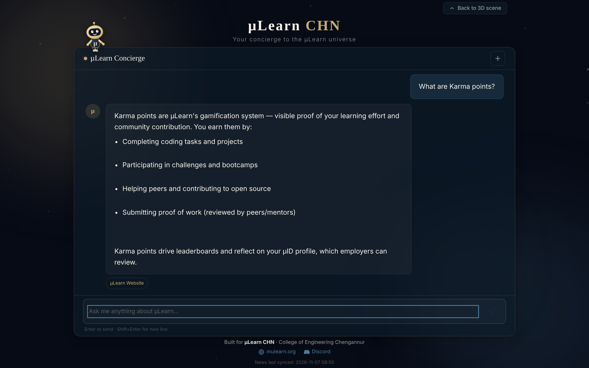

# µLearn Concierge ✦

> A web chatbot for **µLearn CHN** (College of Engineering Chengannur), built for the **AI Interest Group Lead** selection task. It answers questions about µLearn from its own knowledge base and from the latest Discord announcements, and it chats normally about everything else.

**Live demo:** https://mulearn-concierge.onrender.com/
(Free hosting: the first load after a quiet period can take about 30 seconds while the server wakes up.)

**Leadership plan (first 3 months):** [LEADERSHIP_PLAN.md](LEADERSHIP_PLAN.md)



---

## What it does

- **Answers µLearn questions with sources.** Interest Groups, Karma points, the µID, campus chapters, events and news. Answers that come from the knowledge base show a source chip (µLearn Website or µLearn Discord).
- **Says "I'm not certain" instead of guessing.** If the knowledge base has nothing relevant, the bot says so and points to mulearn.org and the µLearn Discord.
- **Also chats normally.** Greetings, thanks, jokes and off-topic questions get a natural reply instead of a refusal.
- **Never goes blank.** If the AI providers are down or out of quota, an offline engine (FAQ plus small talk) still answers, and the reply says AI mode is busy.
- **Fresh news.** A follow of the µLearn #announcements channel lets a Discord bot read new posts, which are written into `knowledge/discord_news.md` and searched together with the website knowledge.
- **Mu, the chat buddy.** A small animated robot sits on the top-left edge of the chat card. His head sways, his legs swing, and he reacts with short words: "There you go!" for a good answer, "Oops!" for an error. Click him for a giggle.
- **A scroll-driven 3D intro.** The µLearn logo breaks into particles that rebuild as a desk setup, you zoom into the laptop screen, and a white flash lands you in the chat. Scrolling back replays it, and there is a "Skip intro" button.

## Approach and what makes it different

1. **Retrieval first, model second (RAG).** The knowledge base (`knowledge/*.md`) is split by `## ` headings and indexed with BM25 (`rank_bm25`). The best matching sections go into the prompt, and the model is told to answer from them and to say when it does not know.
2. **A provider chain instead of one API.** `llm.py` tries providers in the order given by `LLM_PROVIDERS` (OpenRouter free models first, then Gemini). Each provider has a time budget, a cooldown after failures, and `<think>` blocks are stripped from reasoning models. One slow or rate-limited provider does not break the chat.
3. **An offline fallback.** `fallback.py` holds the FAQ and small talk, so the demo works even with no API key at all.
4. **News from where µLearn actually posts it.** Most µLearn news is on Discord, so `scripts/discord_sync.py` reads announcements (text, embeds and forwarded messages), and a background thread refreshes them hourly.
5. **A designed interface.** Midnight navy and champagne gold, refined typography, a typewriter reply effect, a 3D intro, and a mascot that reacts to the conversation. Everything respects `prefers-reduced-motion`.

## The 3D intro (scroll-driven)

The page opens with a cinematic WebGL scene built with Three.js, GSAP ScrollTrigger and Lenis (all vendored in `static/vendor`). One master timeline is scrubbed by the scroll bar, so scrolling back plays everything in reverse.

| Phase | What you see |
|---|---|
| 1. Hero | The gold µ logo floats in a starfield. "Scroll to enter" hint |
| 2. Approach | The camera moves in and the logo rotates to the left |
| 3. Transform | The logo dissolves into golden particles that rebuild as a desk workspace: desk, laptop on a stand, tea glass, framed µLearn logo, books, plant, headphones |
| 4. Laptop | The camera lines up with the laptop screen, which shows the real chat UI |
| 5. Zoom in | The camera pushes into the screen until it fills the window |
| 6. Flash and swap | A white flash hides the switch from the 3D scene to the live chat |

Details: the 3D models are built in code (no model files), the scene is paused while you chat to save battery, and shadows and steam are reduced on phones. "Skip intro" jumps straight to the chat, and "Back to 3D scene" returns to the intro. A dead zone around the chat card stops accidental scrolls from replaying it.

## Run it locally

Requires Python 3.10 or newer.

```bash
git clone https://github.com/Govindv7555/mulearn-concierge.git
cd mulearn-concierge

python -m venv .venv
# Windows:  .venv\Scripts\activate
# macOS/Linux:  source .venv/bin/activate

pip install -r requirements.txt
cp .env.example .env          # Windows: copy .env.example .env
# edit .env and add your keys (all optional, see below)

python app.py                 # open http://localhost:5000
```

With **no keys at all** the app still runs in offline mode. Add a key to switch on the AI.

### Environment variables

API keys live only in `.env`, which is git-ignored. Never commit it. `.env.example` lists everything.

| Variable | Purpose |
|---|---|
| `LLM_PROVIDERS` | Provider order, e.g. `openai_compat,gemini` |
| `OPENAI_COMPAT_BASE_URL`, `OPENAI_COMPAT_API_KEY`, `OPENAI_COMPAT_MODEL` | An OpenAI-compatible provider such as OpenRouter. Models are comma-separated and tried in order |
| `GEMINI_API_KEY`, `GEMINI_MODEL` | Google Gemini (backup provider) |
| `SITE_URL` | Optional. Sent to OpenRouter as the referer |
| `DISCORD_BOT_TOKEN`, `DISCORD_CHANNEL_IDS` | Needed only for Discord news sync |
| `DISCORD_AUTO_SYNC`, `DISCORD_SYNC_INTERVAL` | Background sync on/off and interval in seconds |
| `RATE_LIMIT`, `RATE_WINDOW` | Messages per window per IP (default 20 per 600 s) |

### Refresh Discord news (optional)

1. Follow the µLearn announcements channel into a channel of your own server.
2. Create a Discord bot, enable the **Message Content** intent, invite it to that server, and put its token and the channel ID in `.env`.
3. Run `python scripts/discord_sync.py`. The web app also does this by itself every hour when a token is set.

### Run the tests

```bash
pip install -r requirements-dev.txt
pytest tests -q
```

## Demo script: 10 questions to try

| # | Ask | Shows |
|---|---|---|
| 1 | "What is µLearn?" | Platform overview with a source chip |
| 2 | "What are Karma points and how do I earn them?" | Grounded answer from the knowledge base |
| 3 | "How do I join an Interest Group?" | Practical steps |
| 4 | "What is a Learning Circle?" | Peer-group learning |
| 5 | "Tell me about µLearn CHN" | Campus chapter info |
| 6 | "How do I get my µID?" | Profile and portfolio |
| 7 | "Latest news" | Discord announcements |
| 8 | "Hi, how are you?" then "thanks!" | Normal chat, and Mu waves and cheers |
| 9 | "Tea or coffee?" | Off-topic question answered naturally |
| 10 | "When is the next hackathon?" (if not in the news) | Honest "I'm not certain" and a pointer to the official sources, and Mu looks sad |

## Deploy (Render)

Build command `pip install -r requirements.txt`, start command from the `Procfile`:
`gunicorn app:app --bind 0.0.0.0:$PORT --workers 1 --threads 4 --timeout 60`.
Add the environment variables above in the Render dashboard. On the free plan the service sleeps after 15 minutes without visitors, so the first request afterwards takes about a minute. `/api/health` answers instantly without calling any AI, which makes it a good target for an uptime pinger if you want it always awake.

## Project structure

```
app.py               Flask app: /, /api/chat, /api/health, /api/status, rate limit, cache, sync thread
llm.py               Provider chain (OpenAI-compatible and Gemini), timeouts, cooldowns
rag.py               BM25 retrieval over knowledge/*.md
fallback.py          Offline FAQ and small talk
knowledge/           website.md (curated) and discord_news.md (synced)
scripts/             discord_sync.py and development helpers
static/js/           chat.js, buddy.js (Mu), scene.js and timeline.js (3D intro)
static/css/          style.css, intro.css, buddy.css
templates/index.html The single page
tests/               API, RAG, provider fallback and Discord parser tests
```

## Challenges and how I fixed them

| Challenge | Fix |
|---|---|
| Free AI models hit quota (429) or time out | Provider chain with cooldowns, a 20 s total budget, and the offline fallback so the user always gets an answer |
| Reasoning models returned empty text | Larger `max_tokens`, reasoning parameters, and stripping `<think>` blocks |
| Gemini model names retired | Moved to the current model and the `google-genai` SDK, with the model name set in `.env` |
| A non-ASCII "µ" in an HTTP header crashed requests | ASCII-only header helper |
| The bot only answered µLearn topics and felt stiff | Prompt and routing changed so small talk and general questions are answered naturally |
| Discord news arrived as forwarded messages and embeds, not plain text | The sync script reads content, embeds and `message_snapshots` |
| The "last synced" time showed the deploy time | The footer now reads the `> Last synced:` line from `discord_news.md` |
| The 3D intro trapped the scroll bar and caused accidental replays | A dead zone around the chat card and a replay progress guard |
| The mascot was clipped or overlapped the header on short windows | The buddy sizes itself to the space above the card and hides when there is none |

## Limitations

- The website knowledge was written from public µLearn pages and should be re-checked against mulearn.org from time to time.
- Replies from the free OpenRouter models may be logged by that provider. Do not type personal or sensitive information into the chat.
- Conversation history lives in the browser only. The server keeps a short in-memory cache and rate limit, nothing is stored permanently.
- Discord sync depends on the bot staying in the server and following the announcements channel.

## Credits

Built by **Govind Vijay** for µLearn CHN. Uses Flask, rank-bm25, Three.js, GSAP, ScrollTrigger and Lenis (all vendored under `static/vendor`), plus Google Fonts. µLearn name and logo belong to µLearn; this is an unofficial student project. Licensed under the MIT License, see [LICENSE](LICENSE).
